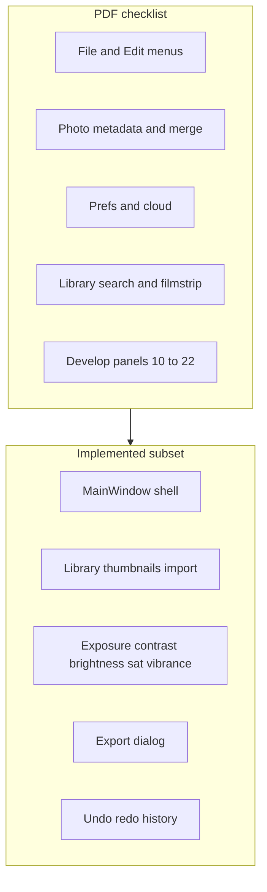

# PhotoEdit — Product roadmap and feature catalog

This document merges the former **LIGHTROOM_IMPLEMENTATION_PHASES.md**, **FEATURES_PLAN.md**, and the phased timeline from **PROJECT_ROADMAP.md**. Source checklist PDF (repo root): [Lightroom_Feature_List.pdf](../Lightroom_Feature_List.pdf).

## Contents

0. [Incremental workflow, dependencies, quality gates, and mandatory pre-implementation plans](INCREMENTAL_WORKFLOW.md) (how to ship small slices; professional shell in section 6.1 of that doc)
1. [Lightroom parity and phased implementation](#part-1-lightroom-parity-and-phased-implementation)
2. [Feature planning catalog](#part-2-feature-planning-catalog)
3. [Delivery timeline and milestones](#part-3-delivery-timeline-and-milestones)

---

## Part 1: Lightroom parity and phased implementation
## Analysis of [Lightroom_Feature_List.pdf](Lightroom_Feature_List.pdf)

**What this file is:** A **structured text inventory** (6 pages) titled *Lightroom Clone Feature List*. It states that features were *extracted from the provided Lightroom features PDF* (screenshots) and grouped for implementation. It is **not** Adobe's official spec -- it is your **derivative checklist** with explicit honesty about unreadable UI chrome.

**Extractability:** Unlike image-only PDFs, this document reads cleanly end-to-end (numbered sections 1-24, bullets, and sixteen "overall feature groups" on pages 5-6).

**Structure:**

| Pages | Content |
|-------|---------|
| 1 | Sections 1-3: File menu, Edit menu, Account/Preferences |
| 2 | Sections 4-9: Photo menu through main workspace outline |
| 3 | Sections 10-15 (start): Profiles through Color Grading / Blending |
| 4 | Sections 15-20 (rest): Balance slider through Crop tool |
| 5 | Sections 21-24 + overall groups 1-16 |
| 6 | Caveat note only |

**Explicit gaps called out in the document itself (do not over-spec):**

- **Section 5 View** and **Section 6 Help**: items exist in sources but text too small to transcribe.
- **Section 7 Export panel**: sidebar present; **exact control labels** not fully readable.
- **Section 22 Masking**: AI/object/sky-style options **inferred**, labels not fully readable.
- **Section 23 Settings / three-dot menu**: actions described qualitatively only.

**Relationship to [Lightroom features.pdf](Lightroom%20features.pdf) in the repo:** Keep **Lightroom_Feature_List.pdf** as the **planning source of truth** for bullets; treat the older file as the original visual reference if you need to verify labels later.

**Coverage sanity check:** Sections **11-22** map cleanly onto a classic **Develop-module** ordering (Basic -> Curve -> Color -> Mixer -> Grading -> Effects -> Detail -> Optics -> Geometry -> Crop -> Heal -> Mask). Sections **1-4, 8-10, 24** map to **Library/DAM + metadata + merge**. Sections 5-7 are **shell/navigation/export UI**. Section 3 is **cloud/account** (often defer for a desktop clone).

---

## Source inventory (sections 1-24 from Lightroom_Feature_List.pdf)

The following matches **sections 1-24** in [Lightroom_Feature_List.pdf](Lightroom_Feature_List.pdf).

| # | PDF area | Topics |
|---|----------|--------|
| 1 | File menu | Add Photos, Search My Photos, Import Profiles & Presets, Export, Export with Previous, Edit in Photoshop, Migrate From (Lr Classic / Elements), Exit |
| 2 | Edit menu | Undo/Redo, clipboard, selection, Next/Previous Photo, Albums (create folder/album, delete, rename, leave, abuse report, target album, add photo, share), Stacks, Duplicate/Delete/Remove photo, Preferences |
| 3 | Account / Preferences | Account, Local Storage, General, Import, Interface, Performance, Cloud usage, Manage Account, Plans |
| 4 | Photo menu | Rating (0-5), Flag (pick/reject, levels), Add to Album, Keyword, Edit Date & Time, Rotate/Flip, Auto Settings, Legacy settings, Copy/Paste Edit Settings, Version, Reset, Enhance, Photo Merge (HDR / Panorama / HDR Panorama) |
| 5 | View menu | Display/navigation (labels not fully readable in source screenshots) |
| 6 | Help menu | (labels not fully readable in source screenshots) |
| 7 | Export panel | Export UI; right-side export settings sidebar (exact labels partially unreadable in source) |
| 8 | Search panel | Search box + results/suggestions panel on the right |
| 9 | Main editing workspace | Right edit panel, canvas, bottom filmstrip, tool icons, collapsible adjustment sections |
| 10 | Profiles / Presets | Profile selector; Adobe Color/Landscape/Portrait/Standard/Vivid/Monochrome; Browse All Profiles |
| 11 | Light | Exposure, Contrast, Highlights, Shadows, Whites, Blacks |
| 12 | Tone curve | Point curve, RGB, R/G/B channels, histogram |
| 13 | Color | WB Temperature/Tint, Vibrance, Saturation, WB presets (As Shot, Auto, daylight types, Custom) |
| 14 | Color Mixer | Per-hue adjustments; Color/Hue/Sat/Lum modes; channel buttons |
| 15 | Color Grading | Wheels: Midtones, Shadows, Highlights; Blending, Balance |
| 16 | Effects | Texture, Clarity, Dehaze, Vignette, Grain |
| 17 | Detail | Sharpening, Noise Reduction, Color Noise Reduction |
| 18 | Optics | Remove CA, Enable Lens Corrections, Defringe + purple hue range |
| 19 | Geometry | Upright (Off, Guided, Auto, Level, Vertical, Full), Distortion, Vertical/Horizontal, Rotate, Aspect, Scale, X/Y Offset, Constrain Crop |
| 20 | Crop tool | Aspect ratio, Straighten, Constrain Crop, overlays (Grid, Thirds, ...), Rotate & Flip, handles |
| 21 | Healing Brush | Clone/Heal, Size, Feather, Opacity, Visualize Spots |
| 22 | Masking | Create New Mask; AI/object-style options (labels fuzzy); mask sliders on right |
| 23 | Settings / More | Three-dot menu; edit/reset/copy/paste-style actions |
| 24 | Add photo / Library | Left library panel, grid/filmstrip, main preview, bottom thumbnail strip |

**Overall groups:** import/library, albums/organization, rating/flag/keywords, search, export, edit transfer (history/settings), global corrections (light -> grading), detail/optics/geometry, crop/heal/mask, cloud/account/settings.

---

## Coverage vs current PhotoEdit (`src/`)

Ground truth is implemented code, not the Part 2 checklists below.

| PDF # | Status | Notes |
|-------|--------|--------|
| 1 | Partial | Open/Import/Export/Exit exist [`main_window.py`](../../src/views/main_window.py). Export with Previous (docs/planning/implementation-notes/2026-10-13-export-with-previous.md) and preset import (docs/planning/implementation-notes/2026-10-13-import-export-presets.md) now also exist. Still missing: Search My Photos, Edit in Photoshop, Migrate catalogs. |
| 2 | Partial | Undo/Redo is now state-aware -- **Done** (see docs/planning/implementation-notes/2026-10-13-state-aware-undo-redo.md): each history entry atomically restores controller parameters, slider/curve/HSL/Color Grading UI, the displayed image, export output, and persisted adjustment state, not just the rendered image buffer. Reset adjustments, Copy/Paste edit settings (see docs/planning/implementation-notes/2026-10-13-copy-paste-edit-settings.md), and a Preferences dialog (see docs/planning/implementation-notes/2026-10-13-preferences-ui.md) all now exist. A minimal v1 of Albums (flat, single-library collections -- create/rename/delete, add/remove photo, sidebar list) is now **Done** (see docs/planning/implementation-notes/2026-10-13-collections.md); still missing from the fuller Edit-menu album surface: folder/album nesting, leave/abuse-report/share, target-album, and Stacks. Select All/None (see docs/planning/implementation-notes/2026-10-13-multi-select-batch-actions.md, which also added the multi-select this depends on) and Next/Prev photo (docs/planning/implementation-notes/2026-10-13-next-previous-photo.md) are both now **Done** too -- this row's "still missing" note on them was stale. **Remove/Delete photo** (a 3-way "Remove from Library" / "Delete from Disk" / "Cancel" confirmation on the filmstrip's context menu, single and multi-select, see docs/planning/implementation-notes/2026-10-13-remove-delete-photo.md) is now **Done for v1 scope** too. Still missing: **Duplicate** (virtual copies) -- deliberately deferred, see that same note: every catalog entry is keyed by its file path (`LibraryEntry.path`/`get_entry`/`_require_entry`), so a true Lightroom-style virtual copy (two catalog entries sharing one physical file, each with its own independent adjustment history) needs a new, separate catalog identity scheme (an entry id distinct from its file path) -- a real architectural change, not a small addition. |
| 3 | Partial | A Preferences dialog now exists, scoped to General (confirm-overwrite) and Performance (preview sizes) -- see docs/planning/implementation-notes/2026-10-13-preferences-ui.md. Still a Gap: Local Storage path relocation, Import defaults, Interface theme switching (only one theme exists), threading; no account/cloud (acceptable deferral for desktop MVP). |
| 4 | Partial | Ratings (0-5 stars, see docs/planning/implementation-notes/2026-10-13-ratings.md), pick/reject flags (see docs/planning/implementation-notes/2026-10-13-pick-reject-flags.md), keywords (free-text list, persisted as JSON via LibraryCatalogService, not an XMP sidecar -- see docs/planning/implementation-notes/2026-10-13-keywords.md), Copy/Paste **edit settings** (see docs/planning/implementation-notes/2026-10-13-copy-paste-edit-settings.md), and **Edit Date & Time** (a user-editable `captured_at` library field, separate from the existing import-time `added_at`, with single and batch set actions -- see docs/planning/implementation-notes/2026-10-13-edit-date-time.md) now exist for v1 scope. **Remove/Delete photo** (see docs/planning/implementation-notes/2026-10-13-remove-delete-photo.md, cross-referenced from row 2 above) is also now **Done for v1 scope** from this menu's side. Still a Gap: album actions, Photo Merge, Enhance, Versions, **Duplicate** (virtual copies -- same deliberate architectural-gap deferral as row 2: this codebase's catalog has no entry-identity concept separate from file path), and -- deliberately, within the Edit Date & Time slice itself -- real EXIF `DateTimeOriginal` auto-population at import time (this codebase has no EXIF-metadata-reading infrastructure yet beyond orientation transpose; `captured_at` defaults to `added_at` at import and is only ever corrected by explicit user edit). |
| 5-6 | Gap / unknown | View/Help menus minimal today (PDF Sections 5-6). |
| 7 | Partial | [`export_dialog.py`](../../src/views/export_dialog.py) exists, with overwrite confirmation (docs/planning/implementation-notes/2026-10-12-export-overwrite-confirmation.md), Export with Previous (docs/planning/implementation-notes/2026-10-13-export-with-previous.md), and single-file JSON preset export/import (docs/planning/implementation-notes/2026-10-13-import-export-presets.md); sidebar richness vs PDF Sec.7 unknown. |
| 8 | Partial | Filmstrip-level search box now exists and matches both filename and per-entry keywords (see docs/planning/implementation-notes/2026-10-13-filmstrip-search.md and 2026-10-13-keywords.md). Still a Gap: a dedicated top-level search panel with a separate results/suggestions panel on the right (PDF Sec.8) -- the existing filmstrip search filters in place rather than opening a distinct panel. |
| 9 | Partial | Right adjustments dock, central viewer, and bottom **filmstrip** (`src/views/widgets/filmstrip_view.py`, with its own filter/sort/search controls) all exist -- the filmstrip part of this row was stale. Crop/Heal/Mask are now all wired, interactive tools (see rows 19-20 and 21-22). Still a Gap vs the mockup: Transform remains the one disabled placeholder in the tool icon rail. |
| 10 | Partial | Built-in profile selector ([`builtin_profiles.py`](../../src/models/builtin_profiles.py)) + single-file JSON preset export/import (File menu); no browsable on-disk preset library, no LUT-based presets. |
| 11 | Partial | Exposure, Contrast, Highlights, Shadows, Whites, and Blacks all exist and are wired (`src/processors/tonal_processor.py`) -- this row was stale, they were previously (incorrectly) listed as missing. The legacy, non-LR **Brightness** slider still coexists alongside them, unreconciled; removing or merging it is a product decision, not attempted here since it would mean dropping a working control. |
| 12 | Done | A Tone Curve section with a point-curve editor (`src/views/widgets/curve_editor.py`) exists, with a histogram backdrop drawn *inside* the curve editor itself (`CurveEditor._paint_histogram`, fed by `ToolsPanel.update_curve_histogram`/`MainWindow._refresh_curve_histogram` -- this app's PDF Sec.12 "histogram" gap was itself stale; that wiring has existed since the curve editor's first slice) **and** per-R/G/B channel curve editing (a channel selector bar switches between the master RGB curve and the independent Red/Green/Blue curves, which compose with the master curve and with each other -- `CurveProcessor`, see docs/planning/implementation-notes/2026-10-13-per-channel-curves.md). Matches PDF Sec.12's "Point curve, RGB, R/G/B channels, histogram" in full. |
| 13 | Done | Saturation, Vibrance, Temperature, and Tint all exist and are wired, and WB presets (As Shot, Daylight, Cloudy, Shade, Tungsten, Fluorescent, Flash) now exist (`src/models/wb_presets.py`), each setting Temperature/Tint to directional preset values within this app's own arbitrary `-100..100` slider units -- **not** calibrated Kelvin color temperatures. Still intentionally **not** built: a real pixel-analysis "Auto" white balance (a durable, separate future gap -- needs a gray-world/illuminant-estimation algorithm, not a preset lookup) and a literal "Custom" entry (that state is already implicit the moment Temperature/Tint are manually moved). |
| 14-15 | Done | HSL Color Mixer (8 bands x Hue/Sat/Lum) and Color Grading (Shadows/Midtones/Highlights + Blending/Balance) both implemented; wheels approximated with sliders (see the respective implementation notes). |
| 16 | Done | Texture, Clarity, Dehaze, Vignette, and Grain all implemented (see Phase G implementation notes). |
| 17 | Done | Sharpening, Luminance NR, and Color NR all implemented, completing the Detail group. |
| 18 | Partial | Remove CA and Defringe implemented; no lens-profile-based corrections (no profile database exists -- durable gap). |
| 19-20 | Partial | **Geometry sliders -- Done**: Straighten (rotation, dimension-preserving) plus Distortion, Vertical/Horizontal perspective, Scale, and X/Y Offset (`GeometryProcessor`, full pipeline/undo-redo/export/`ToolsPanel` wiring -- see docs/planning/implementation-notes/2026-10-12-straighten.md and docs/planning/implementation-notes/2026-10-13-geometry-processor.md) now exist. **Crop tool -- Done**: both the data/processing layer (`CropProcessor`, full pipeline/undo-redo/export wiring, `ImageController.on_crop_changed`) and the interactive UI (drag-handle `CropOverlay` with corner/edge handles, rule-of-thirds grid, aspect-ratio presets via `CropToolbar`, wired through `EditingToolStrip`'s Crop button and `MainWindow`) now exist -- see docs/planning/implementation-notes/2026-10-13-crop-processor.md and docs/planning/implementation-notes/2026-10-13-crop-tool-ui.md. Still a real, deliberate Gap (not an oversight, see docs/planning/implementation-notes/2026-10-13-geometry-processor.md section 1): no Upright modes (Auto/Guided/Level/Vertical/Full -- need vanishing-point/horizon detection or a dedicated guided-line UI) and no "Constrain Crop" (needs to compute the valid-pixel quadrilateral left by Geometry's warps and feed it into the crop rectangle, a cross-cutting feature rather than a property of one processor). The row stays "Partial" rather than "Done" because of this Gap. |
| 21-22 | Partial | **Healing -- Done for v1 scope**: both the data/processing layer (`HealingProcessor`, applied FIRST in the pipeline before every other adjustment, full pipeline/undo-redo/export wiring, `ImageController.on_heal_spots_changed`, see docs/planning/implementation-notes/2026-10-13-healing-processor.md) and the interactive UI (click-and-drag spot placement via `HealingOverlay` -- press sets the destination, drag sets the radius live, release commits, with an auto-offset source point and a basic destination/source-circle-plus-connecting-line marker per spot; a `HealingToolbar` with Mode/Feather/Opacity controls applying to the NEXT spot placed, plus Remove Last/Clear All/Apply/Cancel; live-previewed while editing via `ImageController.preview_heal_spots`; wired through `EditingToolStrip`'s Heal button and `MainWindow`, mutually exclusive with Crop/Mask) now exist -- see docs/planning/implementation-notes/2026-10-13-healing-tool-ui.md. Still real, deliberate Gaps: no per-spot selection/move/resize after placement (only Remove Last/Clear All), no draggable source point (always a fixed, auto-computed offset), no visualization beyond the basic circle-plus-line marker. Masking: linear/radial gradient masks **Done** for v1 scope -- both the data/processing layer (`MaskProcessor`, full pipeline/undo-redo/export wiring, `ImageController.on_mask_changed`, see docs/planning/implementation-notes/2026-10-13-mask-processor.md) and the interactive UI (a draggable 2-handle `MaskOverlay` line for linear / an axis-aligned draggable ellipse with 4 edge handles + a center handle for radial, a `MaskToolbar` with the type/invert controls and the 4 local sliders live-previewed while editing, wired through `EditingToolStrip`'s Mask button and `MainWindow`, mutually exclusive with Crop/Heal) now exist -- see docs/planning/implementation-notes/2026-10-13-mask-tool-ui.md. Still real, deliberate Gaps: no brush/freehand masks, no multi-mask stack (single slot only), no full global parameter set within a mask (still just Exposure/Contrast/Saturation/Clarity), no AI/sky/subject selection, no radial rotation (v1 is axis-aligned-only). Both halves of this row now have real, if deliberately limited, v1 UI coverage -- the row stays "Partial" rather than "Done" because of the Gaps listed above for each. |
| 23 | Partial | Some actions via menus; no dedicated overflow/settings pattern. |
| 24 | Partial | [`library_view.py`](../../src/views/library_view.py) left panel + thumbs, plus a bottom filmstrip (`filmstrip_view.py`) -- the "no bottom filmstrip" note here was stale. The left panel's sidebar now also lists user-created collections (flat v1, see docs/planning/implementation-notes/2026-10-13-collections.md) alongside the three smart collections. **Multi-select + batch metadata actions -- Done for v1 scope**: the filmstrip's `QListWidget` now uses `ExtendedSelection` (Ctrl/Shift-click, Ctrl+A, all free from Qt), and its right-click context menu batch-applies Favorite/Rating/Flag/"Add Keywords"/"Add to Collection" to the whole selection when more than one item is selected (single-click-opens-in-editor is completely unaffected -- see docs/planning/implementation-notes/2026-10-13-multi-select-batch-actions.md). This closes the "no bulk/multi-select across entries" gap this row and the Keywords/Collections notes previously called out. Still a Gap vs PDF Sec.24, as a deliberate, documented v1 scope boundary: no multi-select in the main image viewer itself (it only ever shows one current image), no batch export (a separate, already-tracked future feature), and no drag-to-multi-select marquee beyond what `ExtendedSelection` gives for free. |

**Infrastructure already valuable for future panels:** [`ProcessingWorker`](../../src/processing/processing_worker.py), [`Debouncer`](../../src/utils/debouncer.py), command pattern ([`adjustment_commands.py`](../../src/commands/adjustment_commands.py)), [`ImageController`](../../src/controllers/image_controller.py).



---

## Implementation phases (small, PDF-aligned)

Each phase is **one reviewable slice** (UI + models + processors + tests for that slice). Order balances **dependency** (DAM before sync settings) and **user value** (global develop before local tools).

### Phase A -- Library DAM and workspace chrome (PDF 8-9, 24; parts of 1-2, 4)

- Sort/filter; optional simple **collections** or folders (subset of Albums/Album folders) -- **Done** for the minimal v1 scope this bullet asked for: a single flat list of user-named collections per library, with sidebar rows (count badge + "+ New Collection"), a filmstrip filter mode, and a right-click "Add to Collection" context menu action (see docs/planning/implementation-notes/2026-10-13-collections.md). Deliberately **not built**, as a documented non-goal rather than an oversight: nesting/album folders, drag-and-drop, smart/rule-based collections, collection reordering, and cross-library collections. **Multi-select batch-add was called out here as blocked on "no multi-select exists anywhere in this codebase" -- that gap is now closed** (see the multi-select bullet and the PDF Sec.24 coverage-table row below): a selection of more than one image's right-click menu now includes "Add to Collection (N)", adding every selected image to the chosen collection in one action.
- **Ratings** and **pick/reject** (or flags); **keywords** on disk or sidecar (design choice: XMP vs JSON) -- **Done**: Ratings (0-5 stars, mirroring the existing Favorite flag) are **Done** (see docs/planning/implementation-notes/2026-10-13-ratings.md), pick/reject flags (a tri-state "none"/"pick"/"reject" marker, mirroring the same pattern) are **Done** (see docs/planning/implementation-notes/2026-10-13-pick-reject-flags.md), and keywords (a free-text `list[str]` per entry, persisted as plain JSON via the existing `LibraryCatalogService` -- not an XMP sidecar) are now also **Done** (see docs/planning/implementation-notes/2026-10-13-keywords.md).
- **Search** box filtering library -- **Done** (see docs/planning/implementation-notes/2026-10-13-filmstrip-search.md).
- **Filmstrip** or bottom strip + **next/previous photo** (keyboard + UI) -- **Done** (see docs/planning/implementation-notes/2026-10-13-next-previous-photo.md).
- **Multi-select + batch metadata actions** -- **Done** for v1 scope. The Ratings, pick/reject flags, Keywords, and Collections slices above each explicitly deferred bulk/multi-select as a non-goal, citing "no multi-select exists anywhere in this codebase" (confirmed by grep at the time). This slice builds it: the filmstrip's `QListWidget` now uses `QAbstractItemView.SelectionMode.ExtendedSelection` (Ctrl/Shift-click, Ctrl+A -- all free from Qt, nothing hand-rolled), and its right-click context menu batch-applies Favorite (tri-state "Add"/"Remove" label), Rating, Flag (all three: SET every selected image to the same value), "Add Keywords..." (ADD-ONLY/additive -- each image's existing distinct keywords are preserved, new ones appended, never a destructive batch replace), and "Add to Collection" to the WHOLE selection when more than one item is selected. The single "open in editor" flow (one click loads one image into the main viewer) is completely unchanged and unregressed -- multi-select is additive to it, not a replacement. See docs/planning/implementation-notes/2026-10-13-multi-select-batch-actions.md. Deliberate, documented non-goals (the remaining gap): no multi-select in the main image viewer itself (it only ever shows one current image -- a much larger, separate undertaking), no batch export (a separate, already-tracked future roadmap item), and no drag-to-multi-select marquee beyond what `ExtendedSelection` already gives for free.
- Keeps scope smaller than full Lightroom Cloud sharing/stacks.

### Phase B -- Edit/File workflow and preferences MVP (PDF 1--2, 3 subset, 7)

- **Complete state-aware Undo/Redo:** each history entry must retain before/after adjustment payloads as well as rendered results; undo and redo must atomically synchronize controller parameters, all sliders/curve controls, displayed image, export output, and persisted per-image state. The current image-buffer-only history is an acknowledged interim implementation. -- **Done** (see docs/planning/implementation-notes/2026-10-13-state-aware-undo-redo.md).
- **App-level persistence (do early; separate from Phase K project files):** `SettingsService` wrapping `QSettings` -- last open/import directory, last export directory, optional recent-files list, window geometry / dock state, theme name. See [INCREMENTAL_WORKFLOW.md](INCREMENTAL_WORKFLOW.md) section 6. Today this is **missing** in `src/` and is required for a professional feel.
- **Copy/Paste edit settings** between images (requires serializable adjustment dict; feeds Phase K) -- **Done** (see docs/planning/implementation-notes/2026-10-13-copy-paste-edit-settings.md).
- **Export with Previous** (remember last export options; ties to app-level persistence above) -- **Done** (see docs/planning/implementation-notes/2026-10-13-export-with-previous.md).
- **Preferences UI:** Local Storage path, General, Import defaults, Interface (e.g. theme from resources/QSS), Performance (preview size / threading) -- **Partial** (see docs/planning/implementation-notes/2026-10-13-preferences-ui.md; covered: General confirm-overwrite toggle, Performance preview/interactive proxy sizes; deferred: Local Storage path relocation (needs on-disk data migration), Interface theme switching (only one theme exists today), Import defaults (no safe toggle point found in `LibraryController.import_images()`), and any user-facing threading setting) -- **no** cloud/account unless product changes.

### Phase C -- RAW import

- `rawpy` path in [`ImageService`](../../src/services/image_service.py) + file filters (the dependency is declared in [`pyproject.toml`](../../pyproject.toml)).

### Phase D -- Profiles and presets (PDF 10)

- Profile selector (start with built-in looks analogous to Adobe Standard / Monochrome / etc.) -- **Done** (see docs/planning/implementation-notes/2026-10-13-profile-selector.md).
- Import presets subset (e.g. JSON or LUT-based) -- full "Import Profiles & Presets" parity can grow incrementally. -- **Done** (see docs/planning/implementation-notes/2026-10-13-import-export-presets.md).

### Phase E -- Light, Tone curve, Color (PDF 11-13)

- Replace or reconcile **Brightness** with LR-like pipeline: **Highlights, Shadows, Whites, Blacks** + Exposure/Contrast.
- **Point curve** + RGB / R / G / B + histogram backdrop -- **Done** (histogram backdrop existed from the curve editor's first slice; RGB/R/G/B per-channel curve editing added in docs/planning/implementation-notes/2026-10-13-per-channel-curves.md).
- **Temperature/Tint** + WB presets -- **Done** (see docs/planning/implementation-notes/2026-10-13-wb-presets.md).

### Phase F -- Color Mixer and Color Grading (PDF 14-15)

- HSL Color Mixer (per-color Hue/Sat/Lum).
- Grading wheels (shadows/midtones/highlights + blending/balance).

### Phase G -- Effects and Detail (PDF 16-17)

- Texture, Clarity, Dehaze, Vignette, Grain.
- Sharpening, luminance NR, color NR.

### Phase H -- Optics (PDF 18)

- Remove CA, lens corrections toggle, defringe controls.

### Phase I -- Geometry and Crop (PDF 19-20)

- Upright modes (start Auto/Level/Vertical/Full; Guided later). **Deliberately deferred, not an oversight**: Auto/Level/Vertical/Full need vanishing-point/horizon detection (fitting a homography to the image's own line structure) and Guided needs a dedicated click-two-points-per-line overlay UI -- both substantially larger efforts than a plain-slider processor. "Constrain Crop" is deferred alongside Upright for the same reason: it needs to compute the valid-pixel quadrilateral left by an arbitrary combination of Geometry's warps and feed that into `CropProcessor`'s rectangle, a cross-cutting feature connecting two processors' state rather than a property of either alone. See docs/planning/implementation-notes/2026-10-13-geometry-processor.md section 1 (the same documented-gap pattern already used for Masking's deferred brush masks and Healing's deferred per-spot editing).
- Distortion, vertical/horizontal, rotate, aspect, scale, offset -- **Done** for the slider-based half: Straighten (small-angle rotation, see docs/planning/implementation-notes/2026-10-12-straighten.md) plus Distortion/Vertical/Horizontal perspective/Scale/X-Y Offset (`GeometryProcessor`, one combined homography for perspective+scale+offset and a separate single-term radial `cv2.remap` for distortion, full pipeline/undo-redo/export/`ToolsPanel` wiring -- see docs/planning/implementation-notes/2026-10-13-geometry-processor.md) now exist. "Aspect" and "constrain crop" (the crop-rectangle-facing half) remain the Crop tool's own aspect-ratio-preset feature, already Done below.
- **Crop tool** with overlays and aspect presets (can ship crop **before** full upright if needed -- then merge) -- **Done** (see docs/planning/implementation-notes/2026-10-13-crop-processor.md for the data/processing layer and docs/planning/implementation-notes/2026-10-13-crop-tool-ui.md for the interactive drag-handle overlay, aspect-ratio presets, and `EditingToolStrip`/`MainWindow` wiring).

### Phase J -- Healing and Masking (PDF 21-22)

- Healing brush: clone/heal, size/feather/opacity, visualize spots (simplified). **Done** for v1 scope: both the data/processing layer (multi-spot clone/heal, each with size (radius)/feather/opacity, applied FIRST in the pipeline before every other adjustment, full pipeline/undo-redo/export wiring, `ImageController.on_heal_spots_changed(heal_spots)` -- see docs/planning/implementation-notes/2026-10-13-healing-processor.md) and the interactive UI now exist: click-and-drag spot placement (`HealingOverlay` -- press sets the destination center, drag sets the radius live, release commits, with a fixed auto-offset source point and a basic destination-circle/source-circle/connecting-line marker per spot, per the bullet's own "(simplified)" qualifier), a `HealingToolbar` (Mode/Feather/Opacity, applying to the NEXT spot placed only; Remove Last/Clear All/Apply/Cancel), live-previewed while editing via `ImageController.preview_heal_spots`/`get_export_image`'s `heal_spots_override`, wired through `EditingToolStrip`'s Heal button and `MainWindow`, mutually exclusive with Crop/Mask (a three-way exclusion helper) -- see docs/planning/implementation-notes/2026-10-13-healing-tool-ui.md. Real, deliberate v1 gaps: no per-spot selection/move/resize after placement (only Remove Last/Clear All), no draggable source point, no visualization beyond the basic marker.
- Masking: start with **brush / linear gradient / radial** + adjustment stack; AI/sky/subject **later** -- linear/radial gradient masks (single slot, 4-parameter local adjustment stack: Exposure/Contrast/Saturation/Clarity) **Done** for v1 scope: both the data/processing layer (see docs/planning/implementation-notes/2026-10-13-mask-processor.md) and the interactive drag UI (`MaskOverlay`'s 2-handle line / axis-aligned ellipse, `MaskToolbar`'s type/invert/4-slider controls, live-previewed while editing, wired through `EditingToolStrip`/`MainWindow` -- see docs/planning/implementation-notes/2026-10-13-mask-tool-ui.md). Brush masks, a multi-mask stack, the full global parameter set within a mask, AI/sky/subject selection, and radial rotation remain real, deliberate gaps (v1 explicitly cuts them, not an oversight).

### Phase K -- Session persistence (PDF 23; enables B)

- Wire [`ProjectModel`](../../src/models/project_model.py): library entries, per-image adjustment state, optional keyword/rating persistence.
- **Crash-safe draft autosave (professional):** background or event-coalesced snapshot of adjustment state + library index to a temp or sidecar path; on startup, offer recovery if a clean shutdown flag was not set. Requires **K0** schema stability and a detailed plan per [INCREMENTAL_WORKFLOW.md](INCREMENTAL_WORKFLOW.md) section 4. -- **Partial** (covered: the event-coalesced adjustment-state snapshot already existed, via the pre-existing 400ms `_adjustment_persist_timer` + synchronous `LibraryCatalogService._save_catalog()` write-through on essentially every edit; this slice adds the missing clean-shutdown-flag tracking and a one-time "may not have closed cleanly" notice on next launch, see docs/planning/implementation-notes/2026-10-13-crash-recovery-notice.md; not covered: no literal snapshot/sidecar file format, and no restore-from-snapshot flow -- there is nothing to restore beyond what is already continuously persisted).

### Professional shell (non-PDF; plan alongside B and K)

Tracked in [INCREMENTAL_WORKFLOW.md](INCREMENTAL_WORKFLOW.md) section **6.1**. Each item gets its own approved implementation note before coding:

- Export **overwrite confirmation** (and related prefs) -- **Done** (see docs/planning/implementation-notes/2026-10-12-export-overwrite-confirmation.md).
- **Single-instance** behavior (optional lockfile / `QSingleApplication` pattern) -- **Done** (see docs/planning/implementation-notes/2026-10-12-single-instance.md).
- **Update channel** (check for updates, release notes) -- usually post-MVP.
- **Telemetry / analytics** -- **opt-in only**, default off, documented payload.

### Phase L -- Deferred / product decision (PDF 1, 3, 4)

- **Photo Merge** (HDR, Panorama, HDR Panorama).
- **Migrate From** Lightroom/Elements catalogs.
- **Edit in Photoshop**, **Share & Invite**, full **cloud/account** parity.
- Document as **out of scope** for desktop MVP or separate epic.

---

## Practical notes

1. **Dual checklist:** Keep Part 1 (Lightroom phases) and Part 2 (feature catalog) aligned when completing phases (avoid drift).
2. **PDF unreadable sections:** View/Help fine print -- backfill when you have clearer captures.
3. **Testing:** Processor/unit tests per new panel; optional UI tests for library navigation and export presets.
4. **Order and gates:** Follow [INCREMENTAL_WORKFLOW.md](INCREMENTAL_WORKFLOW.md) for phase dependencies, recommended sequence, **mandatory detailed implementation plan before code (section 4)**, test gates per slice, decoupling, logging, **view-vs-logic reskin (5.1)**, **app persistence (6)**, and **professional shell items (6.1)**.

---

## Part 2: Feature planning catalog
# PhotoEdit - Feature Planning Document

## Overview
This document outlines all planned features for the Lightroom-like photo editing application. Features are organized by priority and complexity.

---

## Feature Categories

### 🎯 Core Features (MVP - Must Have)

#### 1. Image Management
- [ ] **Image Import**
  - Single image import
  - Multiple image import (batch)
  - Drag & drop support
  - Supported formats: JPEG, PNG, TIFF, RAW (CR2, NEF, ARW, etc.)
  - Folder import/scanning

- [ ] **Image Library View**
  - Grid view of imported images
  - Thumbnail display
  - Image metadata display (filename, date, size)
  - Image selection (single/multiple)
  - Sorting options (name, date, size)
  - Filter/search functionality

- [ ] **Image Viewing**
  - Full-screen image display
  - Zoom in/out (mouse wheel, buttons)
  - Pan/drag when zoomed
  - Fit to window / 100% / Fit to width / Fit to height
  - Before/After comparison view
  - Side-by-side comparison

#### 2. Basic Adjustments
- [ ] **Exposure Controls**
  - Exposure slider (-5 to +5 stops)
  - Contrast adjustment
  - Highlights adjustment
  - Shadows adjustment
  - Whites adjustment
  - Blacks adjustment

- [ ] **Color Adjustments**
  - Saturation
  - Vibrance
  - White balance (temperature, tint)
  - Color grading (shadows, midtones, highlights)

- [ ] **Tone Curve**
  - RGB curve editor
  - Channel-specific curves (R, G, B)
  - Preset curves

#### 3. Essential Tools
- [ ] **Undo/Redo**
  - Full undo/redo stack
  - Keyboard shortcuts (Ctrl+Z, Ctrl+Shift+Z)
  - History panel showing operations
  - Clear history option

- [ ] **Image Export**
  - Export single image
  - Export multiple images (batch)
  - Format options (JPEG, PNG, TIFF)
  - Quality settings
  - Resize options
  - Metadata inclusion options

- [ ] **Project Management**
  - Save project (preserve edits)
  - Load project
  - Auto-save functionality
  - Project file format (JSON/XML)

---

### Important features (Should Have)

#### 4. Advanced Adjustments
- [ ] **Detail Enhancement**
  - Sharpening (amount, radius, detail, masking)
  - Noise reduction (luminance, color)
  - Clarity adjustment

- [ ] **Lens Corrections**
  - Distortion correction
  - Chromatic aberration removal
  - Vignette correction
  - Profile-based corrections

- [ ] **Transform Tools**
  - Rotation (90°, 180°, custom angle)
  - Flip horizontal/vertical
  - Crop tool (with aspect ratio presets)
  - Straighten tool

- [ ] **Local Adjustments**
  - Gradient filter
  - Radial filter
  - Brush tool (for selective adjustments)

#### 5. Filters & Effects
- [ ] **Preset Filters**
  - Vintage filters
  - Black & white conversions
  - Color grading presets
  - Custom preset creation
  - Preset management (save/load/delete)

- [ ] **Creative Effects**
  - Vignette
  - Grain/texture
  - Split toning
  - Color lookup tables (LUTs)

#### 6. Metadata & Organization
- [ ] **Metadata Viewing**
  - EXIF data display
  - Camera settings (ISO, aperture, shutter speed)
  - GPS data (if available)
  - Custom metadata fields

- [ ] **Organization Tools**
  - Keywords/tags
  - Ratings (1-5 stars)
  - Color labels
  - Collections/folders

---

### 🚀 Advanced Features (Nice to Have)

#### 7. Advanced Editing
- [ ] **HDR Processing**
  - Merge multiple exposures
  - Tone mapping
  - Ghost removal

- [ ] **Panorama Stitching**
  - Merge multiple images
  - Auto-alignment
  - Blending options

- [ ] **Focus Stacking**
  - Merge multiple focus points
  - Depth map generation

#### 8. Batch Operations
- [ ] **Batch Processing**
  - Apply same adjustments to multiple images
  - Copy/paste adjustments between images
  - Batch export with naming patterns
  - Watermark application

#### 9. Performance Features
- [ ] **GPU Acceleration**
  - OpenCL/CUDA support
  - Hardware-accelerated processing

- [ ] **Smart Previews**
  - Generate preview files
  - Faster editing workflow
  - Offline editing capability

#### 10. Advanced UI Features
- [ ] **Customizable Interface**
  - Dockable panels
  - Customizable toolbars
  - Workspace presets
  - Keyboard shortcut customization

- [ ] **Multi-Monitor Support**
  - Secondary display for image
  - Extended workspace

- [ ] **Dark/Light Themes**
  - Multiple theme options
  - Custom color schemes

---

### 🔮 Future Considerations

#### 11. AI/ML Features
- [ ] Auto-enhancement suggestions
- [ ] Object removal (content-aware fill)
- [ ] Sky replacement
- [ ] Face detection and enhancement
- [ ] Auto-tagging

#### 12. Collaboration Features
- [ ] Cloud sync
- [ ] Share presets
- [ ] Collaborative editing

#### 13. Plugin System
- [ ] Plugin architecture
- [ ] Third-party plugin support
- [ ] Custom filter development

---

## Feature Priority Matrix

### Phase 1: MVP (Minimum Viable Product)
**Goal**: Basic photo editing functionality

1. Image import and viewing
2. Basic adjustments (exposure, contrast, saturation)
3. Undo/redo
4. Image export
5. Simple library view

**Estimated Complexity**: Medium
**Timeline**: Foundation for all other features

### Phase 2: Core Editing
**Goal**: Professional editing capabilities

1. Advanced adjustments (highlights, shadows, curves)
2. Detail enhancement (sharpening, noise reduction)
3. Transform tools (crop, rotate, straighten)
4. Preset filters
5. Project save/load

**Estimated Complexity**: High
**Timeline**: Core editing experience

### Phase 3: Workflow Enhancement
**Goal**: Efficient workflow

1. Batch operations
2. Metadata management
3. Organization tools (tags, ratings)
4. Local adjustments (gradient, radial, brush)
5. Lens corrections

**Estimated Complexity**: Very High
**Timeline**: Professional workflow

### Phase 4: Advanced Features
**Goal**: Advanced capabilities

1. HDR processing
2. Panorama stitching
3. GPU acceleration
4. Customizable UI
5. Plugin system

**Estimated Complexity**: Very High
**Timeline**: Advanced features

---

## Feature Complexity Assessment

### Low Complexity
- Basic sliders (exposure, contrast)
- Simple image viewing
- Basic export
- Undo/redo (with proper architecture)

### Medium Complexity
- Tone curves
- Transform tools
- Preset system
- Metadata display
- Batch export

### High Complexity
- Local adjustments (gradient, brush)
- Lens corrections
- Noise reduction algorithms
- HDR merging
- Panorama stitching

### Very High Complexity
- GPU acceleration
- Plugin system
- AI/ML features
- Cloud sync

---

## User Workflow Scenarios

### Scenario 1: Quick Edit
1. Import image
2. Apply auto-enhance or preset
3. Fine-tune exposure/color
4. Export

### Scenario 2: Professional Edit
1. Import RAW file
2. Adjust exposure and white balance
3. Apply tone curve
4. Enhance details (sharpening, noise reduction)
5. Local adjustments (gradient, brush)
6. Apply lens corrections
7. Final color grading
8. Export high-quality JPEG

### Scenario 3: Batch Processing
1. Import multiple images
2. Edit one image
3. Copy adjustments to all
4. Fine-tune individual images if needed
5. Batch export with naming pattern

---

## Technical Requirements per Feature

### Image Formats Support
- **Input**: JPEG, PNG, TIFF, RAW (via rawpy)
- **Output**: JPEG, PNG, TIFF
- **RAW Support**: CR2, NEF, ARW, ORF, RAF, etc.

### Performance Targets
- **Image Loading**: < 2 seconds for 24MP RAW
- **Adjustment Preview**: Real-time (< 100ms)
- **Export**: < 5 seconds for 24MP JPEG
- **UI Responsiveness**: 60 FPS for zoom/pan

### Memory Management
- **Large Image Handling**: Tiled processing for > 50MP
- **Cache Management**: Configurable cache size
- **Memory Limits**: Graceful handling of memory constraints

---

## Feature Dependencies

```
Image Import
    └──> Image Viewing
            └──> Basic Adjustments
                    └──> Advanced Adjustments
                            └──> Local Adjustments

Undo/Redo (required for all editing features)
    └──> History Service
            └──> Command Pattern

Image Export
    └──> Image Processing
            └──> Format Handlers

Batch Operations
    └──> Single Image Editing (all features)
            └──> Project Management
```

---

## Notes

- Features should be implemented incrementally
- Each feature should be fully functional before moving to next
- User testing should occur after each phase
- Performance should be monitored throughout development
- Features can be added/removed based on user feedback

---

## Next Steps

1. [x] Feature planning (this document)
2. [ ] Prioritize features for MVP
3. [ ] Create detailed specifications for Phase 1 features
4. [ ] Design UI mockups for core features
5. [ ] Begin implementation

---

## Part 3: Delivery timeline and milestones
## 🗺️ Implementation Phases

### Phase 1: Foundation (MVP)
**Goal**: Basic photo editing functionality

**Tasks:**
1. Set up project structure
2. Create base models (ImageModel, ProjectModel)
3. Implement basic services (ImageService, FileService)
4. Create main window with basic layout
5. Implement image loading and display
6. Create basic adjustment controls (exposure, contrast, saturation)
7. Implement command pattern and undo/redo
8. Add image export functionality
9. Create simple library view

**Deliverables:**
- Working application with basic editing
- All Phase 1 features with unit tests
- Professional UI layout

**Estimated Time**: 4-6 weeks

---

### Phase 2: Core Editing
**Goal**: Professional editing capabilities

**Tasks:**
1. Advanced adjustments (highlights, shadows, whites, blacks)
2. Tone curve implementation
3. Detail enhancement (sharpening, noise reduction, clarity)
4. Transform tools (crop, rotate, flip, straighten)
5. Preset filter system
6. Project save/load functionality
7. History panel UI

**Deliverables:**
- Full adjustment suite
- Preset system
- Project management
- All Phase 2 features with tests

**Estimated Time**: 6-8 weeks

---

### Phase 3: Workflow Enhancement
**Goal**: Efficient professional workflow

**Tasks:**
1. Batch operations (copy/paste adjustments, batch export)
2. Metadata management (EXIF viewing/editing)
3. Organization tools (keywords, ratings, color labels, collections)
4. Local adjustments (gradient filter, radial filter, brush tool)
5. Lens corrections (distortion, chromatic aberration, vignette)
6. Before/After comparison views
7. Histogram widget

**Deliverables:**
- Complete workflow tools
- Organization system
- Local adjustment tools
- All Phase 3 features with tests

**Estimated Time**: 8-10 weeks

---

### Phase 4: Advanced Features
**Goal**: Advanced capabilities and polish

**Tasks:**
1. HDR processing
2. Panorama stitching
3. GPU acceleration (if feasible)
4. Customizable UI (dockable panels, workspace presets)
5. Plugin system architecture
6. Performance optimization
7. Advanced filters and effects
8. UI polish and animations

**Deliverables:**
- Advanced editing features
- Extensible architecture
- Polished UI
- All Phase 4 features with tests

**Estimated Time**: 10-12 weeks

---

## 📊 Development Workflow

### For Each Feature:
1. **Plan**: Review feature requirements
2. **Design**: Create/update technical specs
3. **Test First**: Write unit tests (TDD approach)
4. **Implement**: Write code to pass tests
5. **Refactor**: Clean up and optimize
6. **Test**: Ensure all tests pass
7. **Commit**: Commit feature with tests
8. **Push**: Push to repository

**Key Rule**: Every feature includes tests, and every feature gets committed when complete!

### Daily Workflow:
1. Pull latest changes
2. Create feature branch
3. Write tests first (TDD)
4. Implement feature
5. Run test suite
6. Commit feature with tests
7. Push to repository

**See [DEVELOPMENT_WORKFLOW.md](../DEVELOPMENT_WORKFLOW.md) for detailed workflow guidelines.**

---

## 🧪 Testing Workflow

### Test Requirements:
- [x] Unit tests for all new features
- [x] Integration tests for workflows
- [x] UI tests for user interactions
- [x] Edge case coverage
- [x] Error handling tests
- [x] Performance benchmarks (where applicable)

### Test Execution:
```bash
# Before committing
pytest --cov=src --cov-report=term

# Before PR
pytest --cov=src --cov-report=html
# Review coverage report
```

---

## 📐 Code Quality Standards

### Code Style:
- Follow PEP 8
- Use type hints for all functions
- Maximum line length: 100 characters
- Use meaningful variable names
- Document all public APIs

### Architecture:
- Follow MVC + Service Layer pattern
- Keep components loosely coupled
- Single Responsibility Principle
- DRY (Don't Repeat Yourself)

### Performance:
- Optimize image processing operations
- Use threading for heavy operations
- Implement caching where appropriate
- Monitor memory usage

---

## 📝 Documentation Requirements

### Code Documentation:
- Docstrings for all classes and functions
- Type hints for all function signatures
- Inline comments for complex logic
- README updates for new features

### User Documentation:
- Feature documentation (as features are added)
- Keyboard shortcuts reference
- User guide (future)

---

## 🎨 UI/UX Checklist

For each UI component:
- [ ] Follows design guidelines ([UI_UX.md](../UI_UX.md))
- [ ] Dark theme implemented
- [ ] Keyboard shortcuts work
- [ ] Responsive to window resizing
- [ ] High DPI support
- [ ] Smooth animations
- [ ] Accessible (keyboard navigation, screen reader support)
- [ ] Error states handled gracefully
- [ ] Loading states shown
- [ ] Tooltips for complex controls

---

## 🔍 Review Checklist

Before marking a feature complete:
- [ ] All tests pass
- [ ] Code coverage meets targets
- [ ] Follows architecture patterns
- [ ] UI follows design guidelines
- [ ] Documentation updated
- [ ] No linter errors
- [ ] Performance acceptable
- [ ] Error handling comprehensive
- [ ] User feedback considered

---

## 📅 Milestones

### Milestone 1: MVP Complete
- Basic editing functionality
- Professional UI
- Core tests passing
- **Target**: End of Phase 1

### Milestone 2: Professional Editing
- Full adjustment suite
- Preset system
- Project management
- **Target**: End of Phase 2

### Milestone 3: Complete Workflow
- Batch operations
- Organization tools
- Local adjustments
- **Target**: End of Phase 3

### Milestone 4: Advanced Features
- HDR/Panorama
- Customizable UI
- Plugin system
- **Target**: End of Phase 4
